# netrodrone: a 3D-printed net launcher powered by an AEG V2 gearbox

The V2 gearbox's motor, gears, piston and spring make one puff of air per cycle. Here that air
fires **four weights from four angled barrels**, and the weights pull a folded **1.2 m net**
out of a cup in the middle. The parts are printable. The gearbox halves are your own model
(`GearBox V2 lower`), improved, and every fit you made for your components is kept unchanged.

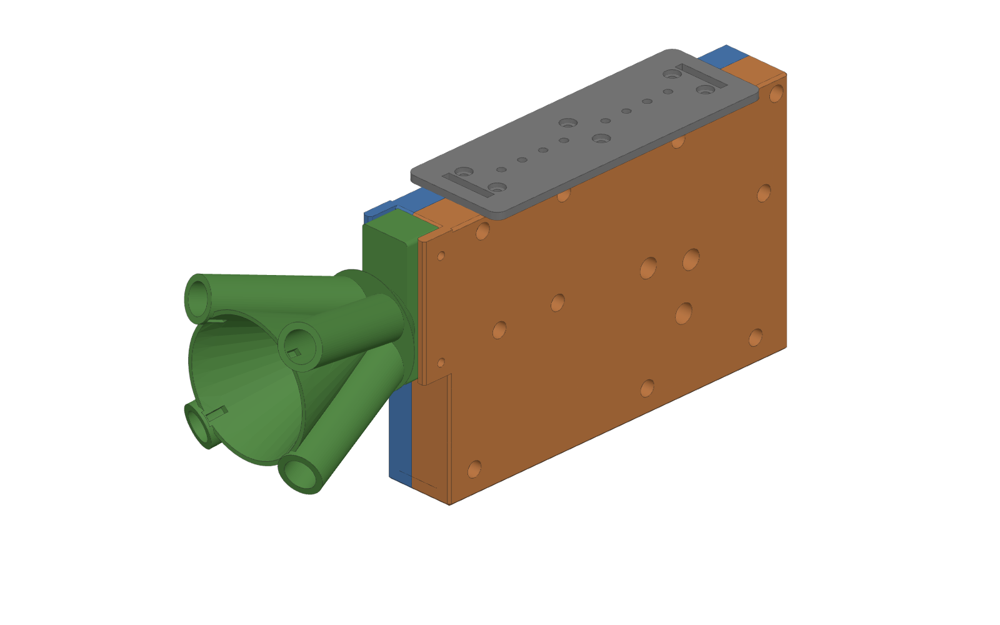

## Will it work? Short answer

Yes, at short range. The physics simulation (spring → piston → air → weights → net in flight)
predicts, with an **M120** spring:

| | |
|---|---|
| weight speed out of the barrels | **9.3 – 10.0 m/s** |
| net 70 % open / 90 % open | ~1.5 m / ~2.1 m |
| **capture window** (net ≥ 70 % open and still moving > 3 m/s) | **1.5 m → 3.6–3.8 m** |
| time from sector-gear release to weights out | 11 ms |
| net drop from gravity | ~0.4 m at 1.5 m, ~0.7 m at 2 m: aim high (see [Aiming](#aiming)) |

That is about what a published 850 g spring-driven UAV net launcher achieved (reliable capture at
3 m). An M150 spring stretches the window to ~4.2 m.

**Three things are required. Leave any one out and the weights do not leave the barrels:**

1. **A check valve in the launcher head.** Your design fixes the AEG nozzle with pins, so there is
   no tappet plate to open the air path. With the barrels sealed by the weights, pulling the
   piston back would leave a near-vacuum in the cylinder (0.08 bar absolute). The head has a one-way valve
   (a 6 mm airsoft BB on a printed seat) that lets air in while cocking and closes during the shot.
2. **An O-ring on every weight.** A bare printed weight leaks too much air.
3. **Barrel volume no bigger than the cylinder's swept volume (~22 cc).** A V2 cylinder holds very
   little air. Bigger or longer barrels (for example 4 × 14 mm × 100 mm) let the air expand
   below atmospheric pressure before the weights get out.

Full numbers: [analysis/RESULTS.md](analysis/RESULTS.md).

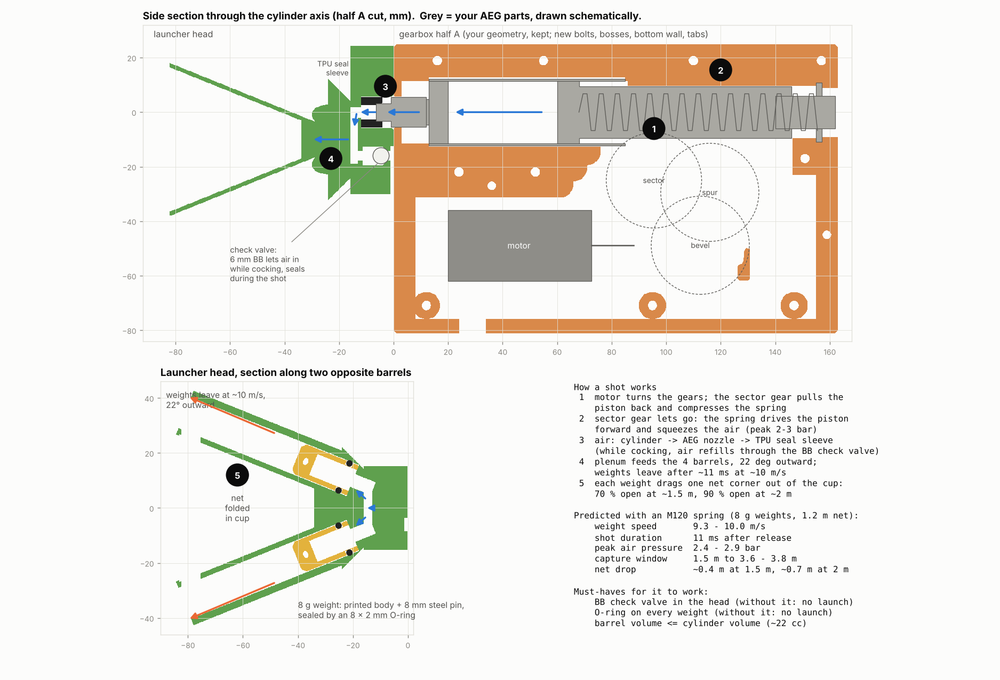

### What actually flies out

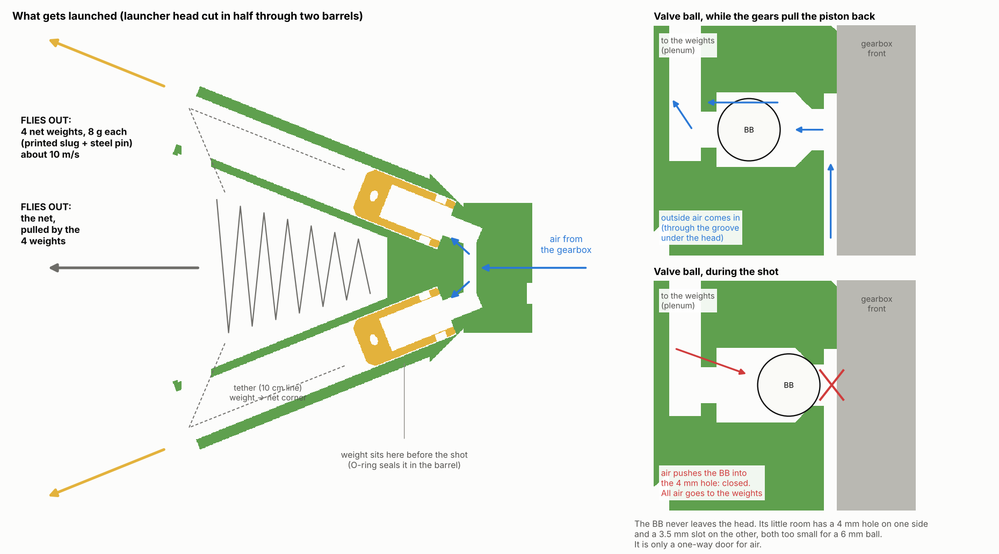

Only the four weights and the net leave the launcher. The AEG spring is the only energy
source: the piston squeezes the air to about 2.5–3 bar, and the air pushes each weight with
about 20 N. No BB is fired. The one BB in the head is the valve ball, a one-way door for air
that stays inside. Details: [docs/RESEARCH.md §1](docs/RESEARCH.md#1-what-pushes-what).

---

## Using it on a drone: which method works best

Every capture method we came up with was simulated against the same target, with the same
rule for "caught": 6,704 runs from hover to 6 m/s (22 km/h). The winner is to **come from
above with automatic aiming**. The V2 launcher then catches about 95 % of the time, either
fired straight down from 3–4 m above or fired forward from 1–1.8 m above and 2–3 m behind.

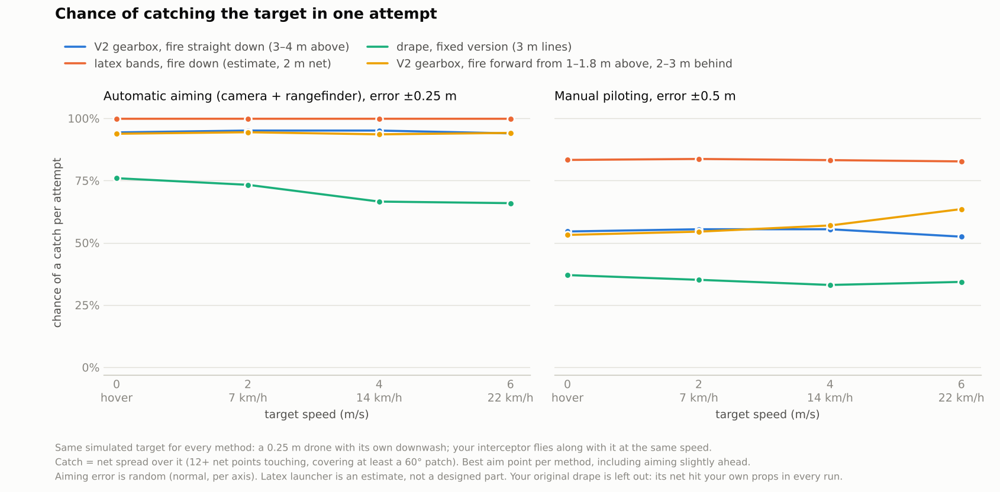

- **Aim automatically.** A downward camera plus a rangefinder is the biggest single upgrade:
  aimed by hand, the catch rate drops to about 55 %.
- **Try your current mount first.** Firing forward fails only when you're level with the
  target. From above and behind, the net arcs down and lands open, even in a 6 m/s headwind.
  This is the least certain result, so ground-test it first.
- **The latex upgrade:** a launcher with a 2 m net would catch more (83 % even aimed by hand)
  at about half the weight. It is an estimate; not designed yet.
- **The drape tactic:** the fixed version is the lightest (~0.2 kg) but catches less. Your
  original version put the net into your own props in every run.
- **Target speed:** attack drones on their attack run (50–300 km/h) are far too fast for any
  thrown net. Design for hovering spotters, slow movers and drones waiting on the ground.

Detection, tactics, latex bands, the drape idea, fast targets, attack-drone speeds and market
size are all in **[docs/RESEARCH.md](docs/RESEARCH.md)**. The scripts are in
[analysis/tactics/](analysis/tactics/).

---

## What is in this repo

| path | what |
|---|---|
| `cad/out/stl/` | **print these** (already oriented flat for printing) |
| `cad/out/step/` | STEP for every part, all in one shared assembly frame, plus `netrodrone_assembly.step` |
| `cad/source/gearbox_v2_original.step` | your original file, unchanged (the input) |
| `cad/build_netrodrone.py` | parametric build: change a number at the top, re-run, get new STEP/STL |
| `cad/verify.py` | geometry checks: collisions, wall thickness, your fits unchanged, air paths open |
| `analysis/` | the physics: `ballistics.py` (shot), `netflight.py` (net in flight), `run_analysis.py` (all figures and tables) |
| `analysis/tactics/` | using it on a drone: firing modes, drape tactic, fast targets, and the head-to-head method comparison ([README](analysis/tactics/README.md), [results](analysis/tactics/RESULTS.md)) |
| `docs/RESEARCH.md` | the findings: what pushes what, tactics, detection, latex bands, attack-drone speeds, market size, with sources |
| `docs/figures/` | scripts that redraw the CAD pictures and 3D renders in `docs/images/` |
| `docs/images/` | figures used here |

### Parts to print

| file | material | qty | notes |
|---|---|---|---|
| `gearbox_half_A.stl` | PETG / ABS / ASA / PA | 1 | your thick half (`BLOCK (1)`), outer face down |
| `gearbox_half_B.stl` | same | 1 | your thin half (`BLOCK (1) (1)`), outer face down |
| `launcher_head.stl` | PETG | 1 | rear face down, barrels up. **Print pause at ~11 mm to drop in the valve BB** |
| `net_weight_x4.stl` | PETG | 4 (one plate) | 100 % infill |
| `nozzle_seal_sleeve_S5…S17_TPU.stl` | TPU 95A | 1 | pick the length that fits your nozzle ([see below](#1-measure-two-things-on-your-parts-first)) |
| `mount_plate.stl` | PETG | 1 | optional drone mount |

---

## What changed in your gearbox files

Your file has three bodies. `BLOCK (1)` and `BLOCK (1) (1)` are the newer matched pair (their
split line sits 3 mm off the cylinder axis), so those are the base. `BLOCK` (the first,
symmetric version) is not used.

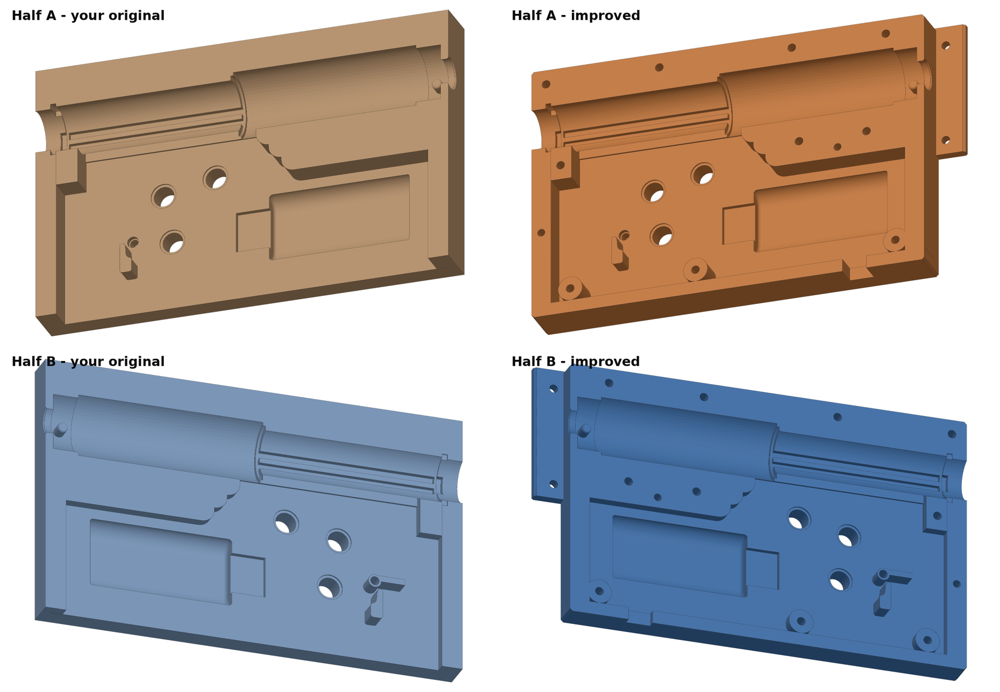

| change | why |
|---|---|
| **Closed the open bottom** with a 5 mm wall, plus a 10 × 12 mm slot for the motor wires | the gear pocket was open along the whole bottom edge: weak, and open to dirt and fingers |
| **10 × M3 through-bolts**: counterbores in half A, hex nut traps in half B | the original had no way to hold the halves together. Bolts only go where both halves are solid, or through new bosses |
| **3 bolt bosses** inside the gear pocket at the bottom | so the bottom bolts clamp solid material, not an empty gap |
| **2 dowel holes** (3 mm pins) | keeps the halves aligned so the bushings stay concentric and the gears do not bind |
| **Two tabs** reaching forward from the front face | hold the launcher head; screws go in from the sides where you can reach them |
| **6 M3 insert holes in the top face** | drone mount (matching plate included) |
| 1 mm chamfer on outer edges | handling, and less elephant's foot on the print bed |

**Kept exactly:** cylinder Ø25.5 mm, cylinder-head seat and nozzle pins, piston channel and
rails, spring-guide seat, 8 mm bushing holes and counterbores, motor pocket, anti-reversal latch
features, sector-gear clearance. `cad/verify.py` casts 33,000 rays through your original
halves and the new ones, and confirms the geometry differs **only** at the new holes, bosses,
bottom wall and chamfers. All new holes keep ≥ 1.2 mm of wall (≥ 1.0 mm around nut traps).

---

## Launcher head

| front | rear (mates with the gearbox) |
|---|---|
| 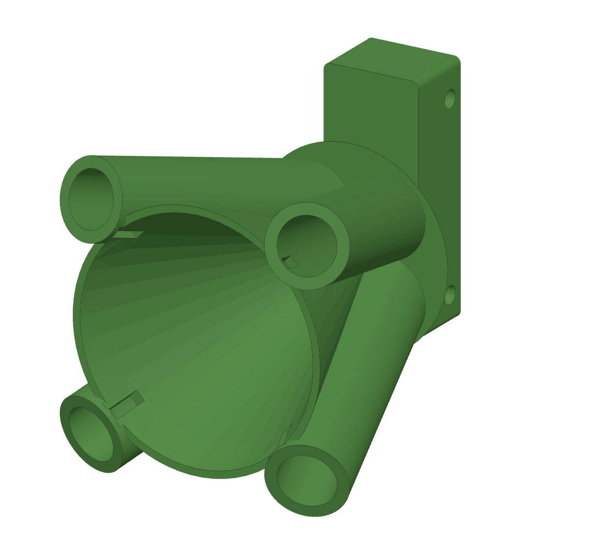 | 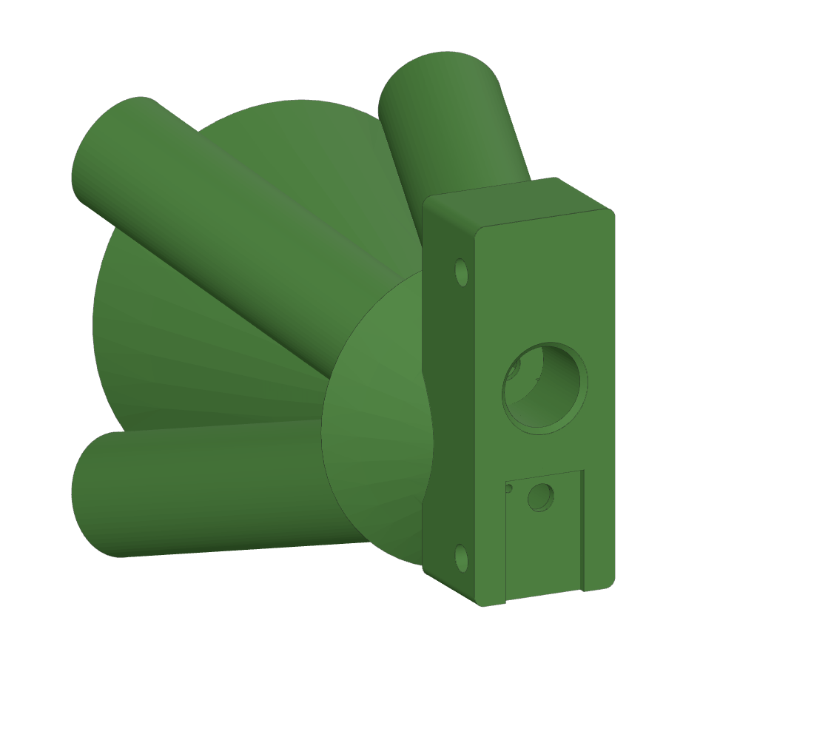 |

- **4 barrels**, Ø12 mm bore, 22° outward from the launch axis, 42 mm of travel for the weights.
- **Net cup**: the cone between the barrels holds about 47 cm³ of folded net. A notch at each
  muzzle lets the corner tether pass into the cup.
- **Air path**: AEG nozzle → TPU seal sleeve → 4.5 mm inlet → plenum → 5 mm feed hole behind each weight.
- **Check valve + bleed** (rear face, inside the vent groove): the valve refills the cylinder
  while cocking. The 1 mm bleed lets air out while you push the weights in, so they don't get
  pushed back out. It costs about 3 % of speed.
- The launch axis sits 10 mm below the cylinder axis, so the head never sticks up past the
  gearbox's top face (flat for mounting).

**Net weight**: printed body Ø11.7 × 22 mm, an Ø8 × 15–16 mm steel pin glued into the back
(dowel pin or cut rod, about 6 g), one 8 × 2 mm NBR O-ring, and a 1.8 mm cross-hole in the nose for
the tether. Total about 8 g.

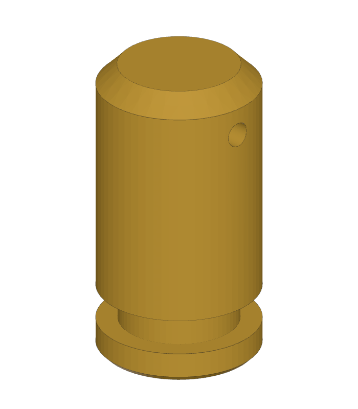

---

## Predicted performance

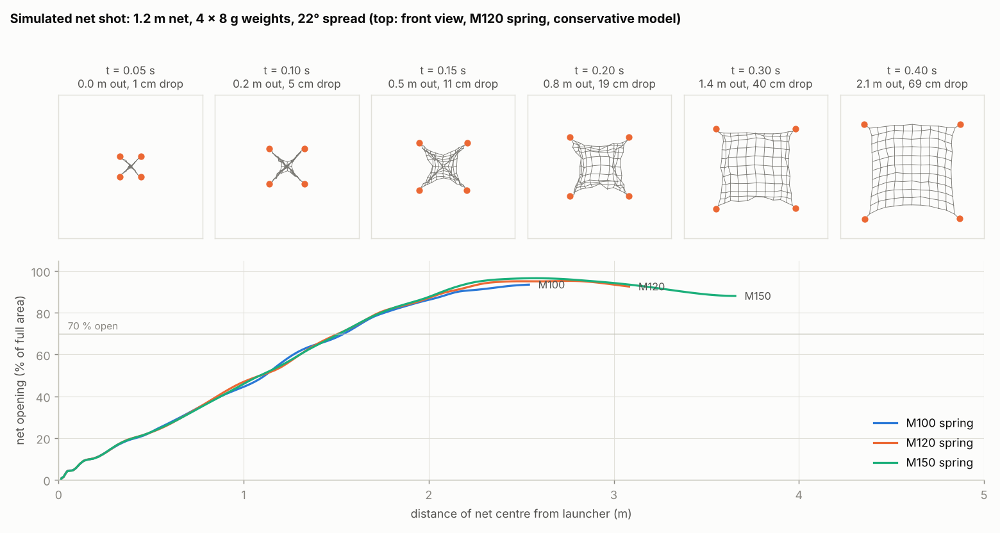

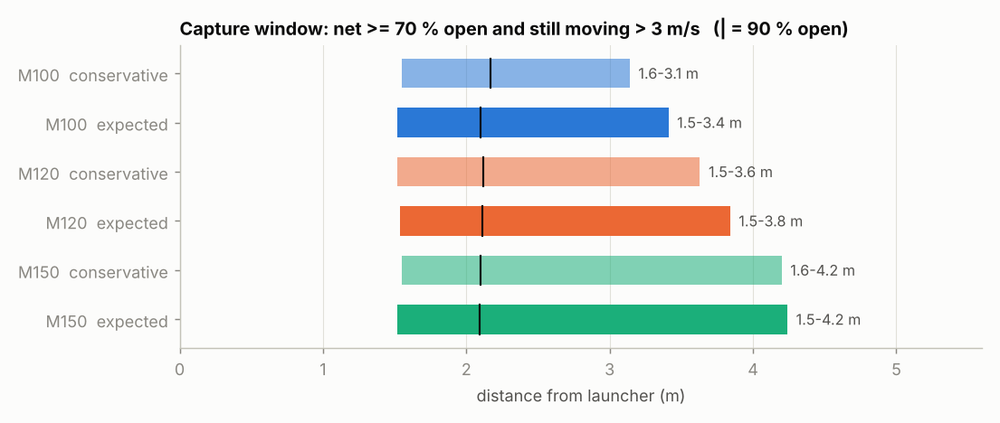

| spring | weight speed (m/s) | capture window |
|---|---|---|
| M100 | 7.5 – 8.5 | 1.5 – 3.1/3.4 m |
| **M120** (recommended) | **9.3 – 10.0** | **1.5 – 3.6/3.8 m** |
| M150 | 11.6 – 11.9 | 1.5 – 4.2 m |

Ranges come from two ways of turning an AEG spring rating into a force (see
[Assumptions](#assumptions-and-limits)). Weight mass (6–12 g) barely changes where the net opens:
the spread angle sets that. Heavier weights fly slower but carry the net better in wind.

| spread half-angle | 90 % open at | capture window (M120) |
|---|---|---|
| 18° | 3.0 m | 2.0 – 4.0 m |
| **22°** (built) | 2.1 m | 1.5 – 3.6 m |
| 26° | 1.7 m | 1.2 – 3.2 m |
| 30° | 1.4 m | 0.9 – 2.9 m |

To change it, edit `THETA` in `cad/build_netrodrone.py` and re-run the script.

<details><summary>One shot in detail, and weight speed vs mass</summary>

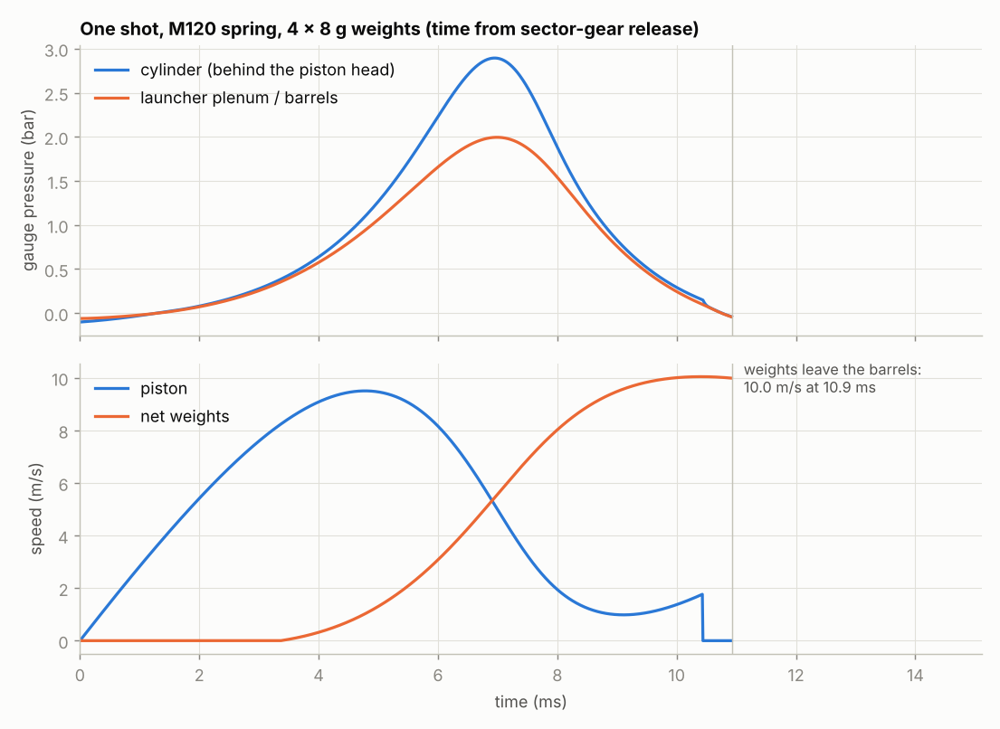
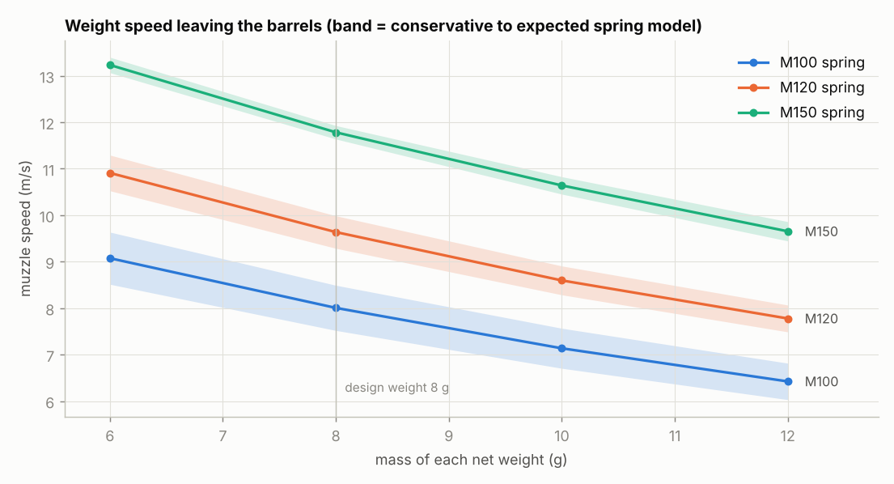

Peak air pressure is 2.4–2.9 bar (M120), 4.2–4.8 bar (M150). Printed walls are many times
stronger than this needs. The air in front of the piston cushions it, so it reaches the
cylinder head at under 3 m/s, much gentler than a normal AEG dry-fire.
</details>

### Aiming

The net falls about **0.4 m by 1.5 m** and **0.7 m by 2 m**. Either aim about 15° above the
target, or mount the launcher tilted up 10–15° on the drone. Test-shoot once and mark the impact
point on your FPV feed (OSD crosshair).

Against a moving target, don't fire level: the headwind folds the net back. Fire from
1–1.8 m above and 2–3 m behind, or straight down from 3–4 m above, as described in
[Using it on a drone](#using-it-on-a-drone-which-method-works-best).

---

## Parts list

**From your V2 AEG:** gear set with 8 mm bushings, piston with head and O-ring, full cylinder,
cylinder head, air nozzle, spring (**M120** recommended), spring guide, anti-reversal latch, motor.

**Hardware**

| qty | part |
|---|---|
| 10 | M3 × 25 socket-head cap screw (DIN 912) + M3 hex nut (DIN 934): gearbox halves |
| 2 | 3 × 12 mm steel dowel pin (or 3 mm steel rod) |
| 10 | M3 heat-set insert for a Ø4.0 mm hole (e.g. M3 × 5.7 × 4.6): 6 in the top face, 4 in the head |
| 4 | M3 × 8 button-head screw: gearbox tabs → head |
| 6 | M3 × 8 button-head screw: mount plate → gearbox |
| 4 (+spares) | O-ring 8 × 2 mm NBR (ID 8, cross-section 2) |
| 4 | steel pin Ø8 × 15 or 16 mm (dowel pin, or cut Ø8 rod) |
| 1 | 6 mm airsoft BB, 0.25 g: check-valve ball |
| — | silicone grease (O-rings only, **not** the valve) |

**Net:** 1.2 × 1.2 m, 80–100 mm mesh, knotted braided PE (Dyneema) line 0.3–0.4 mm (20–40 lb),
0.5 mm perimeter line, about 13 g. Four 10 cm tethers from the corners to the weights.

**Electronics:** a ≥ 30 A logic-level MOSFET module (or an AEG MOSFET) with a flyback diode, a
servo-PWM-to-switch input (or a small microcontroller), and 16–18 AWG wire. See [Firing](#firing-control).

**Mass:** about 400 g of printed parts with the settings below, plus the AEG internals, so roughly
**700–750 g** complete. Use a drone with that much payload margin. To save weight, print the
gearbox halves with 3 walls and 20 % infill (about 90 g less).

---

## Printing

| part | settings |
|---|---|
| gearbox halves | PETG, ABS, ASA or nylon. 0.2 mm layers, 4–5 walls, 5 top/bottom layers, 35 % gyroid, no supports, brim. PLA is fine for a test fit but creeps under spring load. |
| launcher head | PETG, **0.15 mm layers** (smoother bores), 4 walls, 40 % infill, **no supports** (only short bridges, ≤ 21 mm). **Add a pause at Z ≈ 11 mm** (anywhere from 8 to 11.4 mm, M601/M0): drop one 6 mm BB into the small round valve chamber near the bottom of the head, check it sits on the cone seat, resume. |
| net weights | PETG, 0.15 mm, 100 % infill, upright |
| seal sleeve | TPU 95A, 100 %, slow (20 mm/s) |
| mount plate | PETG, 0.2 mm, 4 walls, 40 % |

**After printing the head:**
1. Ream each bore by hand with a 12.0 mm drill bit, then test-slide a weight with its O-ring
   (light grease). It should push in firmly and stay put.
2. Clear the bleed hole (small hole next to the valve, in the rear groove) with a 1.0 mm drill.
3. Valve test: blow into the 4 mm seat hole in the rear groove and air should come out of the
   front socket. Suck on it and it should block. Keep the valve dry.

---

## Assembly

### 1. Measure two things on your parts first

The launcher seals onto your AEG nozzle through a small TPU sleeve, and nozzles vary:

1. **Nozzle tip outer diameter.** Set `NOZZLE_TIP_OD` in `cad/build_netrodrone.py` (default
   6.0 mm) and re-run the script. The sleeve grips the tip with 0.4 mm of squeeze.
2. **Tip protrusion `P`**: with the gearbox assembled, how far the nozzle tip sticks out past the
   front face. Then pick the sleeve:

| P (mm) | 10 – 12 | 7 – 10 | 4 – 7 | 1 – 4 | −2 – 1 |
|---|---|---|---|---|---|
| sleeve | S5 | S8 | S11 | S14 | S17 |

### 2. Build

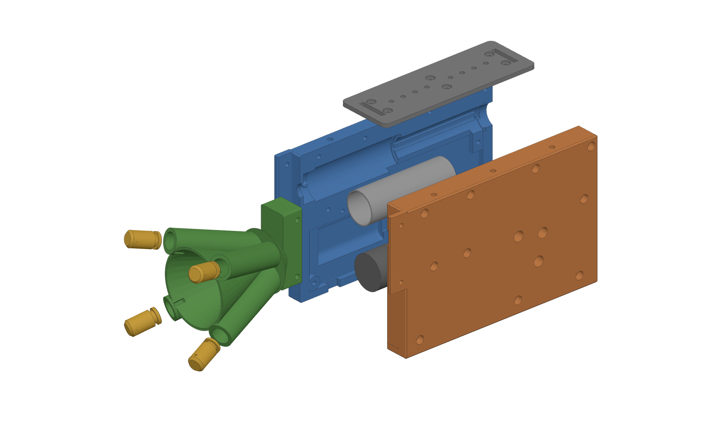

1. Press heat-set inserts into the 6 top-face holes and the 4 holes in the head's flange sides.
2. Press the dowel pins into half B. Fit the bushings.
3. Lay your AEG internals into half A, just as you would in a stock shell: cylinder with head and
   nozzle (the pins catch the nozzle groove), piston, spring, spring guide, shimmed gears, ARL,
   motor. Run the motor wires out through the bottom slot.
4. Close with half B. Fit the 10 M3 × 25 screws from the half-A side with nuts in half B, tighten
   evenly in a cross pattern, and check the gears turn freely.
5. Push the chosen TPU sleeve into the head's rear socket. Slide the head between the two tabs so
   it seats flat on the front face, then fit the 4 M3 × 8 screws.
6. Bolt on the mount plate (6 × M3 × 8).

### 3. Load the net

1. Tie a 10 cm tether from each net corner to a weight's nose cross-hole.
2. Grease the O-rings lightly. Push each weight into a barrel from the muzzle until it stops.
   The bleed lets the trapped air out.
3. Fold the net accordion-style with the 4 corners on top, press it into the cup, and lead each
   tether through its muzzle notch.
4. Optional: a paper disc or light tape over the cup mouth keeps the net in during flight. The
   net tears through it.

---

## Firing control

One gearbox cycle fires one shot. At 11.1 V a cycle takes about 40–50 ms (25 ms of cocking, then
the 11 ms shot), so the delay from trigger to net is under 50 ms. Extra cycles after the shot are
harmless because the barrels are empty.

- **Simple:** flight-controller servo/PINIO output → PWM-switch → MOSFET → motor, on a momentary
  radio switch. Hold for about 0.1 s.
- **Better:** a small microcontroller reads the FC channel and runs the motor for exactly one
  cycle: a calibrated pulse, or a microswitch/hall sensor triggered by the sector gear.
- Always fit a flyback diode across the motor. Keep the launcher on a separate arm switch.

## First tests (on the bench)

1. Dry-cycle with no weights: the cycle should be smooth with no gear noise.
2. Valve and bleed test (see Printing).
3. Load 4 weights without a net and shoot into a pillow 1 m away. Film it at 240 fps next to a
   ruler. You should see 8–10 m/s with M120.
4. Shoot with the net at 2–3 m, then adjust the aim offset.

---

## Changing the design

All dimensions are parameters at the top of `cad/build_netrodrone.py` (spread angle, bore,
barrel length, weight size, sleeve, bolt positions and more). After editing:

```bash
pip install -r requirements.txt
python cad/build_netrodrone.py      # writes cad/out/step and cad/out/stl
python cad/verify.py                # collisions, walls, your fits unchanged, air paths open
python analysis/run_analysis.py     # re-runs the physics and figures (~30 s)
```

If you change the bore or barrel length, keep `4 × bore area × travel` at or below ~20 cc
(the cylinder only has ~22 cc). The analysis shows what happens if you don't.

## Assumptions and limits

- **AEG dimensions assumed:** cylinder bore 23 mm, piston stroke 52 mm, piston 20 g, nozzle bore
  4 mm. If yours differ, edit `analysis/ballistics.py`. A 4 mm shorter stroke costs about 5 %.
- **Spring force** isn't published for AEG springs. The rating means the BB speed in m/s with
  a 0.20 g BB (M120 ≈ 120 m/s). The spring is therefore calibrated by simulating a stock AEG
  under two loss assumptions, giving 59–88 N cocked and 2.3–3.5 J stored for M120. Predictions
  are shown for both.
- **Net model:** 11 × 11 mass-spring grid, tension-only lines, line drag Cd 1.2, net about
  9 g/m². Real knots and folds add some scatter. Treat the distances as ±20 %.
- Gear clearances to the new bolt bosses assume V2 gear radii of about 18 mm (clearance ≥ 5 mm).
  Check with your gears before the final print.
- Not modelled here: wind, a moving target, wear of the printed bores. Moving targets and
  drift are covered in [analysis/tactics/](analysis/tactics/).

## Safety and legal

The weights leave at about 10 m/s, enough to injure an eye. Wear eye protection when testing,
and never aim at people or animals. In many countries, capturing or disrupting someone else's
drone is illegal. Use this only on your own drones and test targets, and check your local rules.
