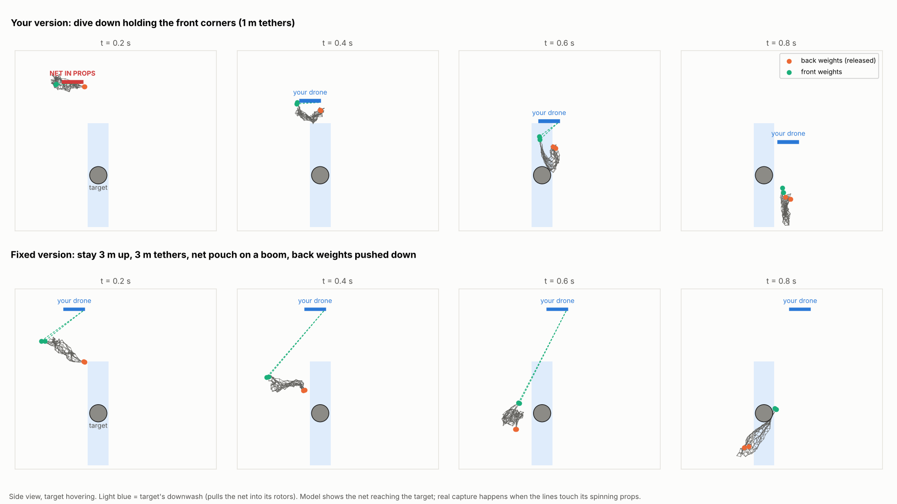

# Research notes: using the launcher, and which method works best

These notes collect the studies done after the launcher was designed:
- how the shot works;
- how to fire from a drone;
- finding the target;
- the drape idea;
- fast targets;
- a head-to-head comparison of every capture method;
- how attack drones move;
- the market.

Numbers marked as simulated come from the scripts in [`analysis/tactics/`](../analysis/tactics/).
Treat them as ±20 % until a ground test confirms them. Everything else cites its source.

**Short version**
- Come from above. Fired straight down from 3–4 m above the target, or forward from 1–1.8 m
  above and 2–3 m behind it, the V2 launcher catches about 95 % of the time with automatic
  aiming. That holds for targets from hover up to 6 m/s (22 km/h).
- Automatic aiming (camera + rangefinder) is the biggest single upgrade. Aimed by hand, the
  catch rate drops to about 55 %.
- A latex-band launcher with a 2 m net would be better and lighter, but it is only an estimate
  so far.
- Attack drones on their attack run (50–300 km/h) are far too fast for any thrown net. Design
  for the slow phases: hovering spotters, slow movers, drones waiting on the ground.

Contents:
1. [What pushes what](#1-what-pushes-what)
2. [Firing from a drone: airspeed and direction](#2-firing-from-a-drone-airspeed-and-direction)
3. [Ideas and how to test them](#3-ideas-and-how-to-test-them)
4. [Finding the target and the stealth-from-above tactic](#4-finding-the-target-and-the-stealth-from-above-tactic)
5. [Latex bands as the energy source](#5-latex-bands-as-the-energy-source)
6. [The drape tactic](#6-the-drape-tactic)
7. [Which method is most efficient](#7-which-method-is-most-efficient)
8. [Fast targets (150 km/h)](#8-fast-targets-150-kmh)
9. [How attack drones move, and what speed to design for](#9-how-attack-drones-move-and-what-speed-to-design-for)
10. [Market size](#10-market-size)
11. [Safety and legal](#11-safety-and-legal)

---

## 1. What pushes what

No BB is fired. The only energy source is the AEG spring, and the motor just loads it again
each cycle. "M120" is only the spring's rating (about 120 m/s with a 0.2 g BB), used to
estimate its force. The one BB in the head is a valve ball: a one-way door for air that never
leaves the head.

What happens in one shot, with an M120 spring (simulated):

1. **Motor → gears → piston.** The sector gear pulls the piston back 52 mm and squeezes the
   spring to about 60–90 N, storing 2.3–3.5 J. The low pressure lifts the valve ball off its
   seat, so fresh air refills the cylinder.
2. **Spring → piston.** The gear lets go, and the spring drives the piston forward at up to
   about 9 m/s.
3. **Piston → air.** The air in the cylinder reaches about 2.5–3 bar. It pushes back on the
   piston with about 100–120 N, which cushions it before it hits the cylinder head.
4. **Air → weights.** The air goes through the AEG nozzle into the head and seats the valve
   ball, so none escapes there. It pushes each weight with up to about 20–23 N.
5. **Weights → net.** After 42 mm of barrel the four 8 g weights leave at 9–10 m/s. They pull
   the net corners through 10 cm tethers, and the net opens.

What flies out is the four weights and the net. About half the spring's energy (1.4–1.6 J)
ends up in the weights. The rest goes to friction, heating the air, and stopping the piston.

## 2. Firing from a drone: airspeed and direction

Simulated, M120 spring, 1.2 m net, target at the same height as the launcher
(`airspeed.py`, `down_strike.py`):

| how you fire | where the net can catch |
|---|---|
| hovering, firing forward | 1.5–3.6 m ahead |
| flying 4 m/s, firing forward | 1.5–2.2 m (never fully opens) |
| flying 8 m/s, firing forward | almost nothing (1.4–1.5 m) |
| flying 12 m/s, firing forward | never opens: the headwind folds it back like a flag |
| **hovering above, firing straight down** | **2.0–5.2 m below** |

**Firing down while both drones drift sideways together**: gravity keeps the net moving, but
the air pushes it back. How far the net centre lags behind the target:

| shared speed | 3 m below | 4 m below |
|---|---|---|
| 0 m/s | 0 m | 0 m |
| 2 m/s | 0.11 m | 0.16 m |
| 4 m/s | 0.24 m | 0.34 m |
| 6 m/s | 0.40 m | 0.56 m |

The open net is about 1.1 m wide. Up to 4 m/s you can simply fire. Above that, aim 0.3–0.5 m
ahead. Section 7 shows that firing forward also works, if you fire from 1–1.8 m **above** and
2–3 m behind the target, so the net arcs down onto it.

**Constraints**
- **Airspeed:** a level forward shot needs under ~3–4 m/s of airspeed. It's an ambush or hover
  tool, not a chase tool.
- **Timing:** about 0.04 s for the gearbox plus about 0.3–0.5 s of net flight. Trigger
  automatically.
- **Payload:** the V2 launcher is about 0.7 kg, so it needs a heavy-lift drone.
- **Energy:** about 1.5 J per shot. Commercial CO2 net guns reach 3–9 m.
- **Identification:** tell drones from birds before firing.
- **After the catch:** the target falls. Add a small parachute (5–8 m/s descent) or a tow line.
- **Your own props:** the net must never reach them, so climb or brake right after firing.

## 3. Ideas and how to test them

From cheapest to most ambitious:
1. **Automatic trigger.** A small LiDAR rangefinder (TFmini class, ~5 g) plus a camera tracker
   fires when the target is centred at the right range. Section 7 shows it is the biggest
   single gain.
2. **Attack from above, fire down.** Gravity helps the net, and the target's own downwash
   pulls the lines into its rotors.
3. **Towed "trawl" net** for fast chases: a net bag on a light hoop 2–4 m behind or below. At
   speed the airflow holds it open. Not simulated.
4. **Scoop net on a boom.** Simple, but your drone must be faster than the target. Not simulated.
5. **More energy** for 5–10 m of range: a CO2 cartridge, or latex bands stretched by a winch
   (section 5).
6. **Lighter catchers:** a bolas (2 weights on a 1.5 m line) or streamers. DARPA tested
   streamers against propellers. Reports say they work on slow drones and struggle against
   fast FPVs.
7. **Two drones carrying one big net (3–5 m).** A huge catch area, but hard formation flying.

How to come up with and test ideas:
1. **Write the chain:** find → identify → get close → fire → tangle → bring down safely →
   reload. The weakest link sets your success rate.
2. **List 3–5 options per link and mix them.** Energy can come from a spring, rubber, CO2 or
   gravity. The catcher can be a net, a line or a bag. Delivery can be firing, dropping,
   towing or scooping.
3. **Kill ideas fast with numbers:** energy, mass, timing, airspeed. The simulators here test
   an idea in minutes.
4. **Test on the ground first:** an old quad with spinning props on a stand behind a safety
   net, filmed at 240 fps. Measure the catch rate against distance and angle.
5. **Change one thing per test**, and log every shot.

Sources:
- [Dronehub: net-capture interceptor physics](https://dronehub.ai/blog/net-capture-interceptor-physics)
- [Dronehub: counter-UAS in 2026](https://dronehub.ai/blog/counter-uas-2026-jamming-kinetic-capture)
- [Airsight: anti-drone methods compared](https://www.airsight.com/blog/anti-drone-weapons-jammers-nets-lasers-compared)
- [Interesting Engineering: LiDAR + AI net interceptor](https://interestingengineering.com/ai-robotics/germany-develops-autonomous-interceptor-drone)
- [Euronews: A1-Falke interceptor](https://www.euronews.com/my-europe/2026/06/01/catching-the-unknown-the-drone-designed-to-hunt-other-drones)
- [Euromaidan Press: 6-shot net module](https://euromaidanpress.com/2026/09/30/most-drone-interceptors-ram-or-explode-this-ukrainian-one-just-throws-a-net-six-shots-to-a-module/)
- [C4ISRNET: DARPA streamers](https://www.c4isrnet.com/unmanned/2021/06/08/darpas-newest-system-kills-drones-with-stringy-streamers/)
- [Breaking Defense: streamers vs FPV drones](https://breakingdefense.com/2024/11/nets-jamming-and-cyber-scalpels-pentagon-weighs-homeland-counter-drone-tech-in-mountain-tests/)
- [UltraNet CO2 net gun](https://netgun.com/netgun-info/ultranet-small-animal-netgun)

## 4. Finding the target and the stealth-from-above tactic

**Acoustic detection**
- **From the ground:** a microphone array hears small quads at roughly 200–300 m in quiet
  conditions, with under 10° of direction error. Wind over 5 m/s degrades it badly.
- **From the flying interceptor:** almost useless. Your own props, about 20 cm from the mics,
  are 40–60 dB louder than a target tens of metres away.
- **Perch and listen:** park the interceptor on a roof or pole with the motors off, and take
  off when it hears something. Two listening points give a position; one gives a direction.
- **What to listen for:** a strong hum at roughly 100–400 Hz with harmonics up to a few kHz.
  A rising pitch (Doppler) means it is coming closer.
- **Hardware:** 4–8 I2S MEMS mics on a 20–40 cm frame plus a Raspberry Pi 5 or Jetson. GCC-PHAT
  gives the direction; a small classifier answers "drone or not".
- **Limit:** 10° at 100 m is about ±17 m. That's enough to point the interceptor and its camera,
  not to aim the net. Hand over to the camera at 20–30 m.

**The tactic**
1. Wait perched, motors off, listening.
2. Launch and climb to about 10 m above the target's height **before** closing in.
3. Approach along the sound bearing, then lock on with a downward camera.
4. Shadow it: 5–8 m above and a few metres behind, copying its track.
5. Strike when it slows or hovers: drop to 3–4 m above and fire down. A downward rangefinder
   fires automatically, and the net reaches it in about 0.4–0.5 s.
6. Climb away. A small parachute on the net brings the target down slowly.

**Stealth caveats**
- Many camera drones (DJI Mavic and Air series) have upward obstacle sensors.
- FPV cameras tilt up 20–40°, so stay behind them.
- Your own downwash (about 7–9 m/s) shakes a target directly below you. Stay offset until the
  last moment.
- Come in with the sun behind you.

Sources:
- [Acta Acustica 2026: MEMS-array detection and localisation](https://acta-acustica.edpsciences.org/articles/aacus/full_html/2026/01/aacus250134/aacus250134.html)
- [Counter-UAS 101: acoustic ranges and wind](https://drone-warfare.com/counter-uas/acoustic-detection/)
- [Mobile microphone-array tracking (error under 10°)](https://www.researchgate.net/publication/383877168_Experimental_Evaluation_of_Acoustic_Drone_Tracking_using_Mobile_Microphone_Arrays)
- [droneAcoustics: onboard self-noise](https://github.com/darkbit404/droneAcoustics)
- [Ego-noise reduction for flying microphones](https://www.researchgate.net/publication/313735711_Microphone-Array_Ego-Noise_Reduction_Algorithms_for_Auditory_Micro_Aerial_Vehicles)
- [Review of acoustic drone detection](https://www.researchgate.net/publication/398339228_A_Review_of_Acoustic_Techniques_for_Drone_Detection)

## 5. Latex bands as the energy source

Latex stores roughly 5–20 times more energy per gram than the AEG's steel spring.

| | flat bands (e.g. TheraBand Gold 0.76 mm) | tubing (slingshot / speargun) |
|---|---|---|
| stretch | about 5× | 3–3.5× (makers warn not to pass ~3.6×) |
| energy (estimate) | ~4–6 J per gram | ~1–1.5 J per gram |
| life | a few hundred shots | longer |

- **Reference points:** slingshot shooters measure 30–90 J from about a 17 kg pull. 16 mm
  speargun tubing pulls about 25 kg at 3.1–3.5×.
- **Sizing:** about 20 J in total (4 bands) is about 5 g of flat band or 15 g of tubing. With
  15 g weights, expect 60–75 % of the stored energy to reach them.
- **Enemies:** sunlight, ozone, heat and oil.
  - Store bands slack and in the shade.
  - Replace them every couple of months (speargun makers say under 90 days).
  - Below about 5 °C they get weaker.
- **Stretching:** don't keep bands stretched, because held bands lose force. Pull them back
  during the climb.
- **Cocking:** four bands need about 250 N. A small self-locking worm-gear winch does it in
  1–2 s. A servo-released latch fires instantly and silently.
- **Safety:** a breaking band snaps back hard. Enclose the bands and wear eye protection.

Estimated performance (the latex launcher is not designed yet):

| | V2 piston (built) | latex bands (estimate) |
|---|---|---|
| weights | 4 × 8 g at 9–10 m/s | 4 × 15 g at 20 m/s |
| net | 1.2 m | 2.0 m |
| launcher mass | about 0.7 kg | about 0.3–0.4 kg (rough) |
| catch window, hovering, firing forward | 1.5–3.6 m | 2.5–6.8 m |
| catch window, flying 8 m/s, firing forward | almost none | 2.5–3.8 m |
| fired down, 4 m/s drift: net lag at 4 m below | 0.34 m | 0.18–0.25 m (coarse vs fine net model) |

Sources:
- [Slingshot Forum: hunting for 100 J](https://www.slingshotforum.com/threads/hunting-for-100-joules.2244/)
- [Slingshot Forum: battle of the bands](https://www.theslingshotforum.com/threads/battle-of-the-bands.41697/)
- [Funcfish speargun band calculator](https://funcfish.com/speargun-band-calculator/)
- [Blue Tuna speargun tubing](https://bluetunaspearfishing.com/products/primeline-premium-small-i-d-speargun-band-rubber-tubing-9-16in14mm-5-8in16mm-11-16in17-5mm)
- [Neptonics: band deterioration](https://www.neptonics.com/blogs/gear-maintenance/band-deterioration)

## 6. The drape tactic

**The idea.** Approach from above and behind, release the two back weights, dive while holding
the two front corners, drag the net over the target, then let go of the front corners. No
launcher needed: the drone's own motion and gravity move the net.

**What went wrong in the original version** (simulated, `drape_run.py`):
- **Your drone dives into its own net.** A released net needs about 0.3 s just to fall at
  3 m/s. A drone diving at 3–5 m/s overtakes it, and the net was inside your props about 0.2 s
  after release.
- **Collision risk:** your drone came within 0.5 m of the target, and reached its height in
  the fastest dive.
- **Instability:** multirotors are unstable in fast vertical dives, because they fall into
  their own downwash.
- **Yank:** when the net snagged, it pulled your drone with about 50 N before the release.

**The fixed version**
1. Shadow about 3 m above and a bit behind the target.
2. Keep the net in a pouch on a boom about 0.5 m below your props, with the front corners on
   3 m lines.
3. Push the back weights down at about 4 m/s with a small spring when you release them.
4. Don't dive. Fly over the target at your height. The net trails down and sweeps through it,
   and the target's downwash pulls it into its rotors.
5. Let go automatically. Use a weak link that snaps at about 15–20 N on each front line, or a
   tension sensor and servo latch. A small parachute on the net slows the fall.
6. Climb away.

| | your version (1 m lines, dive) | fixed version (3 m lines, no dive) |
|---|---|---|
| net reaches the target | 0.6 s | 0.7 s |
| net vs your props | goes inside them | 0.55 m clear |
| your drone's closest distance to the target | 0.5 m (0 m in the fastest dive) | 3 m |
| pull on your drone when the net snags | about 50 N | about 25 N |

Hardware for the fixed version is about 200 g: 2 servo latches, a spring, a boom, a 1.5 m net
and 4 × 20 g weights. Section 7 shows its weak point. The front corners hang only 0.5 m apart,
so the catch zone is narrow from side to side; spreading the front lines wider is the obvious
next fix.

## 7. Which method is most efficient

Every method was simulated against the same target: a 0.25 m drone with its own downwash.
They shared the same air and the same rule for "caught": the net has to land spread over the
target, not as a bundle of line. In total that's 6,704 runs across target speeds and aim
offsets. Each method then got a random aiming error around its best aim point
(`compare_methods.py`, `compare_eval.py`, full tables in
[analysis/tactics/RESULTS.md](../analysis/tactics/RESULTS.md)).

| method | automatic aim (±0.25 m), 0–22 km/h | manual aim (±0.5 m) | time to catch | weight | status |
|---|---|---|---|---|---|
| V2 launcher, fired straight down from 3–4 m above | 94–95 % | 52–55 % | 0.4–0.5 s | ~0.7 kg | needs a down-facing mount |
| V2 launcher, fired forward from 1–1.8 m above, 2–3 m behind | 94 % | 53–64 % | 0.4–0.6 s | ~0.7 kg | current mount |
| latex bands, fired down, 2 m net | 100 % | 83–84 % | 0.4 s | ~0.3–0.4 kg | estimate, not designed |
| drape, fixed version | 66–76 % | 33–37 % | 0.5 s (1.4 s above 14 km/h) | ~0.2 kg | latch and boom not designed |
| drape, original version | 37–88 % | 15–44 % | 0.7 s | ~0.2 kg | net went into your own props in every run |

**What it shows**
- **Height matters more than which way the launcher points.** Firing forward fails only when
  you're level with the target. From above and behind, the net arcs down and lands open,
  even in a 6 m/s headwind. The current forward mount may work as it is, but this is the
  newest and least certain result, so ground-test it first.
- **Automatic aiming is the biggest upgrade.** It takes the V2 from about 55 % to 95 %. At
  14–22 km/h, aim 0.25–0.45 m ahead.
- **The latex launcher wins on paper.** Its 2 m net forgives about 2.5 times more aiming error,
  and it weighs about half as much.
- **The fixed drape is the lightest but the weakest,** because its catch zone is only
  ±0.3–0.6 m wide from side to side.

**Build order**
1. Automatic aim and fire: a downward camera plus a rangefinder.
2. Ground-test the current launcher fired from 1.5 m above and 2–3 m behind a dummy with
   spinning props. Build a down-facing mount only if that fails.
3. Design the latex launcher.

Limits: the model can't simulate props wrapping the lines. All methods got the same aiming
error. A drone waiting on the ground wasn't simulated, but it is the easiest case: it doesn't
move and has no downwash.

## 8. Fast targets (150 km/h)

150 km/h is 42 m/s, 5–10 times faster than this design handles (`fast_target.py`).
- **Chasing doesn't work.** To follow it you fly 150 km/h too, and the air hits the net at
  42 m/s. That is 30–100 times harder than at the 4–8 m/s where it already fails: about
  13–20 N, roughly 100 times the net's weight. The net trails like a flag.
- **Head-on, the net opens, but the timing is tight.** If you hover in its path, the net is
  70 % open 0.31 s after the shot. By then the target has covered 13 m, so you fire when it is
  15–25 m away, with only about ±0.1 s of slack. That needs radar or lidar and automatic
  firing. A 1 g turn moves the target 0.8 m in 0.4 s, and a 3 g dodge moves it 2.4 m, so you'd
  need a 3–5 m net. FPV cameras look forward, so head-on it sees you.
- **A hit doesn't stop it.**
  - A 1.5 kg drone at 42 m/s carries 1,300 J, the same as dropping it from 88 m.
  - The net and weights (about 47 g) wrap it, but it keeps going at about 40 m/s and lands
    35–70 m further on (from 5–20 m up).
  - A net tied to your drone would yank your drone to about 21 m/s.
  - Only a net anchored to poles can stop it: with 1 m of give it must hold about 130 kgf
    for a split second.
- **Warning time:** heard at 300 m, it arrives in about 7 s.

What works at this speed is fixed nets. Ukraine reports 822 km of anti-drone net tunnels over
roads. Russia put up a mesh tunnel over 1.6 km long near Chasiv Yar. The drone does the aiming
and the poles take the energy. Drones have still gotten past open-sided nets by flying over
them, and the success figures are official claims only. Beyond nets, fast attack drones are
handled by military systems.

Speeds for scale:
- A typical 6S 5-inch FPV flies at about 150 km/h, and fast builds reach 200+.
- DJI FPV flies at 54, 97 or 140 km/h, depending on mode.
- A Mavic in sport mode does about 64 km/h (a forum figure).

Sources:
- [Euromaidan Press: 822 km of net tunnels](https://euromaidanpress.com/?p=410039)
- [TWZ: Russian mesh tunnel](https://www.twz.com/news-features/russians-erect-mesh-net-tunnel-over-a-mile-long-to-counter-ukrainian-fpv-drones)
- [Aviacionline](https://aviacionline.com/ukraine-deploys-anti-drone-protection-structures-on-key-roads)
- [Euromaidan Press](https://euromaidanpress.com/?p=361031)
- [Kyiv Post](https://www.kyivpost.com/amp/post/51181)
- [Meduza](https://meduza.io/en/feature/2025/08/05/lines-of-defense)
- [FPV top speeds by build class](https://www.unmannedtechshop.co.uk/fr/blogs/knowledge-base/fpv-drone-top-speed-how-fast-real-world-by-build-class)
- [Droneblog: DJI speeds](https://www.droneblog.com/what-is-the-fastest-dji-drone/)
- [Mavic Pilots forum](https://mavicpilots.com/threads/sports-mode-speeds.6112/latest)

## 9. How attack drones move, and what speed to design for

| what the drone is doing | speed | can this net catch it? |
|---|---|---|
| FPV flying to the target | about 50–60 km/h cruise, 90–120 km/h max | no |
| fiber-optic FPV flying | up to about 60 km/h | no |
| fiber-optic FPV waiting on the ground | 0; reported to land up to 10 km away and wait up to 12 h | **yes, the easiest case** |
| final dive (larger winged attack drones) | about 185 km/h (Switchblade 600) to over 300 km/h (Lancet) | no |
| camera or spotter drone hovering to watch | 0–2 m/s | **yes** |
| a drone moving slowly to a new spot | up to about 6 m/s | **yes**, aim slightly ahead |

There is little public, rigorous research on attack-drone speeds. Most figures are maker specs
or officials' statements. One radar field test measured a small drone's attack manoeuvre at
about 34 km/h, a single flight. NATO papers measure speed, acceleration and turning from drone
tracks to tell drones from birds, which helps a detector but gives no attack statistics.

Others already use nets in this slow range:
- Ptashka Drones drops nets onto drones waiting on the ground, so their props can't spin up.
- WINFLY Spider is a reusable net-gun interceptor. Its makers claim a 15 m range, with the net
  opening 3–5 m out.
- Delft Dynamics DroneCatcher is a net gun on a multicopter.

**So design for 0–6 m/s:** hovering spotters, slow movers, and drones waiting on the ground.
Treat any landed drone as armed and keep your distance.

Sources:
- [Zhakh 7 specs](https://www.blue-bird.tech/en/products/quadrocopter-for-kamikade-or-reconnaissancefpv-7/)
- [NV: fiber-optic ambush tactics](https://english.nv.ua/nation/what-new-tactics-is-russia-using-with-fiber-optic-drones-50507803.html)
- [Kolibri 13-O](https://oboronka.mezha.ua/en/v-ukrajini-kodifikuvali-fpv-dron-kolibri-13-o-na-20-km-309578/)
- [Zhakh 15](https://www.blue-bird.tech/en/products/fiber-optic-fpv-drone-zhah-15/)
- [Daxe](https://daxe.substack.com/p/russias-best-drones-lie-in-wait-beside)
- [Aerocorner: loitering munition speeds](https://aerocorner.com/blog/best-kamikaze-drones/)
- [Quevedo et al. 2019, radar field test](https://ietresearch.onlinelibrary.wiley.com/doi/full/10.1049/iet-rsn.2018.5646)
- NATO STO papers: [1](https://publications.sto.nato.int/publications/STO%20Meeting%20Proceedings/STO-MP-MSG-SET-183/MP-MSG-SET-183-15.pdf), [2](https://publications.sto.nato.int/publications/STO%20Meeting%20Proceedings/STO-MP-MSG-SET-183/MP-MSG-SET-183-06.pdf)
- [Militarnyi: Ptashka nets](https://militarnyi.com/en/news/new-defense-tactic-ptashka-drones-nets-ambush-russian-drones/)
- [Ukrainska Pravda: WINFLY Spider](https://www.pravda.com.ua/eng/news/2026/08/11/8048242/)
- [Electronic Specifier: DroneCatcher](https://www.electronicspecifier.com/robotics/unleashing-the-dronecatcher-for-controlled-interception)

## 10. Market size

Published estimates disagree by about 3 times, so treat them as context, not a business plan.

| report | 2025–2026 | forecast | growth per year |
|---|---|---|---|
| MarketsandMarkets, all counter-drone | $9.2B (2026) | $29.7B by 2031 | 26.5 % |
| Fortune Business Insights, all counter-drone | $11.6B (2025) | $55B by 2034 | 22 % |
| MarkNtel, all counter-drone | $5.1B (2025) | $28B by 2032 | – |
| Meticulous, all counter-drone | $4.1B (2025) | $12.6B by 2036 | 10 % |
| Meticulous, interceptor drones only | $2.5B (2026) | $12.7B by 2036 | 17.5 % |
| Fact.MR, interceptor drones only | $1.6B (2026) | $6.3B by 2036 | 14.6 % |

- **Where nets sit:** inside "mitigation and neutralization", the largest category at about
  42 % of the market (MarkNtel). Military buyers are about 74 %, North America about 52 %.
  There is no public number for net capture alone.
- **Reality check:**
  - Ukraine says it builds 1,000–2,000 interceptor drones a day at about $1,000–5,000 each.
  - 1,000 a day at $3,000 is about $1.1B a year, roughly matching the interceptor estimates.
  - Most of those ram fast attack drones and are lost each time.
- **The niche here:** a cheap, reusable net module for slow targets. Only the net is used up.
  - **Similar products:** WINFLY Spider, Ptashka, Delft DroneCatcher and the SkyWall net
    launcher.
  - **Prices:** SkyWall's maker never published one.
- **Who can buy:** mostly militaries, police and critical-infrastructure operators. In many
  countries only authorized agencies may use drone-stopping equipment, and exports are
  controlled.

Sources:
- [MarketsandMarkets](https://www.marketsandmarkets.com/PressReleases/counter-cuas-systems.asp)
- [Fortune Business Insights](https://www.fortunebusinessinsights.com/) (figure via a search summary)
- [MarkNtel](https://www.bolsamania.com/nota-de-prensa/mercados/global-counter-unmanned-aerial-system-uas-market-set-to-reach-usd-2798-billion-by-2032-as-rising-drone-threats-drive-defense-investments-markntel-advisors--22035252.html)
- [Meticulous: counter-UAS](https://www.meticulousresearch.com/product/anti-drone-counter-uas-market-6669)
- [Meticulous: interceptor drones](https://www.meticulousresearch.com/product/interceptor-drones-market-6961)
- [Fact.MR](https://www.factmr.com/report/drone-interceptors-market)
- [DroneXL](https://dronexl.co/2026/03/29/zelenskyy-ukraine-2000-interceptor-drones-per-day-budget)
- [LIGA](https://news.liga.net/en/amp/politics/news/ukraine-produces-up-to-1000-interceptors-per-day-but-there-are-not-enough-operators-zelensky)
- [Euromaidan Press](https://euromaidanpress.com/2026/04/24/ukrainian-p1-sun-drones-down-3000-plus-shaheds-in-2026-at-about-3000-apiece/)
- [New Atlas: SkyWall](https://newatlas.com/shoulder-mounted-skywall-cannon/42181/?amp=true)

## 11. Safety and legal

- The weights leave at about 10 m/s, enough to injure an eye. Latex bands store several times
  more. Wear eye protection when testing, and never aim at people or animals.
- In many countries, capturing or disrupting someone else's drone is illegal. Only authorized
  operators may intercept drones. Test on your own drones and check your local rules.
- A drone waiting on the ground in a conflict area may carry explosives. Never approach or
  touch one.
